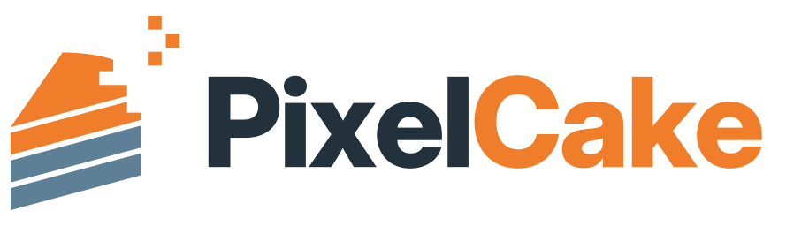

<h1>
  <picture>
    <source media="(prefers-color-scheme: dark)" srcset="assets/pixelcake-orizzontale-negativo.svg">
    
  </picture>
</h1>

**Infrastructure, piece by piece.**

This is the website of PixelCake, a visual designer for small networks that runs in the browser:
you draw the network, configure it, and ask it whether one device reaches another.

Static pages, with nothing to build, in English at the root and in Italian in `it/`:

- `index.html`, `it/index.html`: what PixelCake is and what it does
- `why.html`, `it/why.html`: why I am building it
- `assets/`, shared by both languages: the style sheet, a small script (light and dark theme, the language, the drawings), the logo, and pictures of the app in both themes and both languages (`screenshot-it.png`, `present-it.png`… are the Italian ones)
- `assets/fonts/`: the two typefaces, Inter and JetBrains Mono, served from the site itself, each with its licence
- `tools/drawings.py`: draws the five illustrations and writes them into the pages, each in the language of its page

`EN | IT` in the masthead and in the footer leads to the same page in the other language. Every page names its
other language (`hreflang`) and its own address (`canonical`). Only the English home page moves a visitor: on a
first visit, a browser that puts Italian before English goes on to `it/`. A language chosen with the switch is
kept in the browser (`localStorage`, next to the theme) and wins; without JavaScript nobody is moved.

The pages load nothing from other sites: no trackers, no cookies, no fonts from elsewhere.

The site is served at https://pixelcake.dev by GitHub Pages, from the root of `main`: `CNAME` names the domain, and `.nojekyll` has the files served as they are.

To look at the site, open `index.html` in a browser. To change a drawing, edit `tools/drawings.py` and run it:

```bash
python tools/drawings.py
```

## Licence

The texts, the drawings, the pictures and the logo are © Phil-pje, all rights reserved: see [LICENSE](LICENSE).
PixelCake itself, the application, is free software under the GNU AGPL v3.0.
The typefaces keep their own licence (SIL Open Font License 1.1).

Contact: pixelcake.dev@gmail.com
